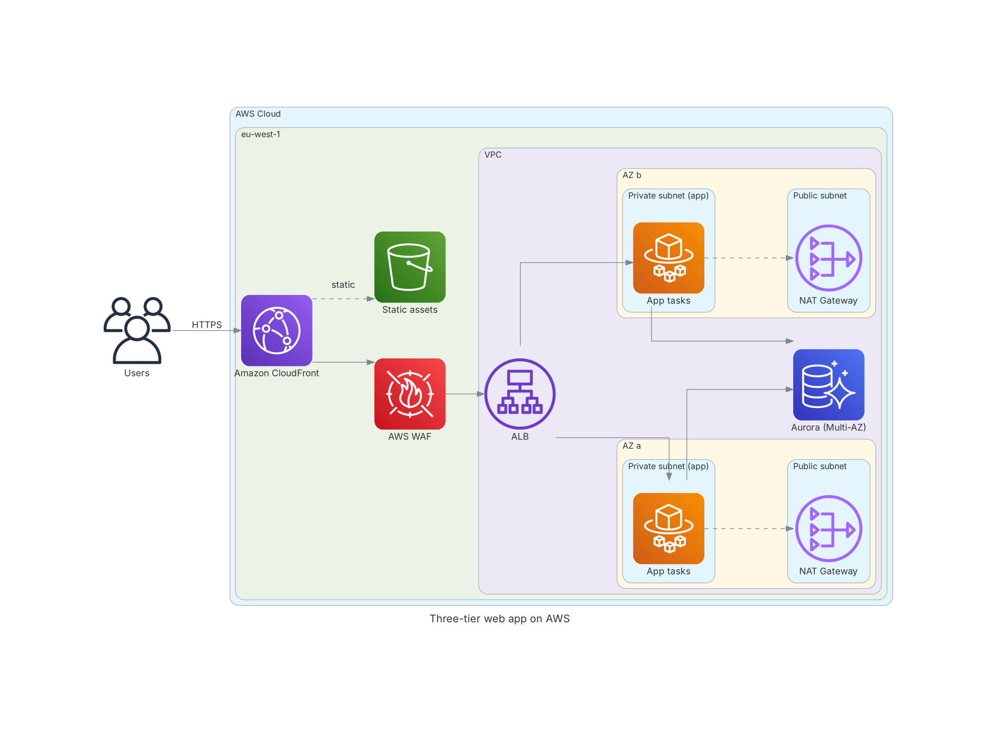
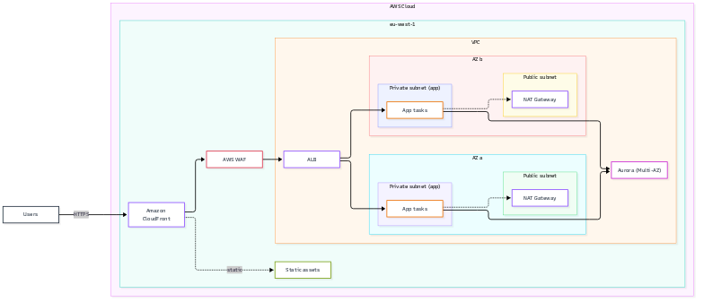
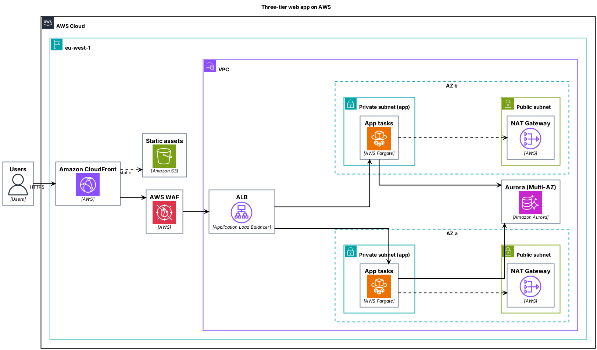

# AWS Solution Architect skill

> Turn Claude into a senior **AWS Solution Architect** that designs, reviews and documents solutions - grounded **only in official AWS documentation** - and draws the architecture for you.

Ask in plain language ("design a PCI-ready payments platform in the EU", "review this architecture", "migrate our VMware estate to AWS", "draw it") and get a decision-ready answer: TL;DR, assumptions, options with trade-offs, a diagram, Well-Architected risks, cost drivers and linked sources.



## What it does

| Capability | Details |
|---|---|
| **Solution design** | Discovery questions that matter, 2-3 options with trade-offs, a recommended design, risks, next steps |
| **Well-Architected review** | Six pillars + lenses (Financial Services, Serverless, SaaS, Generative AI, Migration); severity-rated findings with doc links |
| **Migration** | The 7 Rs per workload, assessment -> mobilize -> migrate, wave planning, tooling, data-transfer maths |
| **Resilience / DR** | RTO/RPO targets, backup-restore -> pilot light -> warm standby -> active/active, static stability |
| **Security & compliance** | Multi-account foundation, Security Reference Architecture, IAM, PCI DSS / DORA / GDPR mapping with correct "shared responsibility" wording |
| **Networking** | VPC layout, Transit Gateway, Direct Connect/VPN, PrivateLink, edge |
| **Cost / FinOps** | Estimation method (Pricing Calculator), cost drivers, purchasing models, controls - no invented prices |
| **DevOps & IaC** | CI/CD, OIDC to AWS (no stored keys), CDK / CloudFormation / Terraform, observability |
| **Data & GenAI** | Analytics decision guide, lake/warehouse, Bedrock RAG, Guardrails, GenAI Lens |
| **Diagrams** | One JSON spec -> **Mermaid**, **draw.io** (official AWS icons), **PlantUML** (AWS icon library), **Python `diagrams`** |
| **Documents** | Solution Design Document, ADR, review report, migration plan, DR plan, cost model, workshop agenda |

## The "official sources only" guarantee

AWS changes fast; confident-but-stale answers are the biggest risk for an architect. This skill:

1. keeps stable design knowledge in `references/`, each claim linked to docs.aws.amazon.com / aws.amazon.com;
2. **verifies volatile facts live** (quotas, prices, Region availability, service names, compliance scope) through an AWS documentation MCP/search tool or fetches limited to AWS domains;
3. when it cannot verify, it says `[verify]` with the link - it never fills the gap from memory;
4. never cites third-party blogs as evidence, and words compliance carefully ("supports / helps meet", never "makes you compliant").

See [`references/source-policy.md`](skills/aws-solution-architect/references/source-policy.md).

## Install

**Claude Code (plugin marketplace)**
```bash
/plugin marketplace add umbertodenaro/skill-aws-solution-architect
/plugin install aws-solution-architect@aws-solution-architect
```

**Claude Code (manual)**
```bash
git clone https://github.com/umbertodenaro/skill-aws-solution-architect.git
cp -r skill-aws-solution-architect/skills/aws-solution-architect ~/.claude/skills/
```

**Claude.ai / other agents that read `SKILL.md`**: zip the folder `skills/aws-solution-architect/` and upload it as a skill.

Recommended companion: an AWS documentation tool (e.g. the AWS documentation MCP server) so live verification works out of the box. The skill still works without it, but marks volatile facts `[verify]`.

## Diagram generator

```bash
cd skills/aws-solution-architect
python3 scripts/render_diagram.py assets/example-spec.json --validate-only
python3 scripts/render_diagram.py assets/example-spec.json --format all -o diagrams/
```
Standard-library Python only. Outputs (see [`docs/example`](docs/example)): `.mmd` (Mermaid), `.drawio` (open in diagrams.net), `.puml` (PlantUML + official AWS icon library), `.py` (runs with `pip install diagrams` + Graphviz). 88 service entries; **every icon identifier is checked against upstream** (draw.io AWS4 library, `awslabs/aws-icons-for-plantuml`, the `diagrams` package) by `scripts/verify_catalog.py`, which also runs in CI - a missing icon becomes a labelled box, never a guessed name.

| Mermaid | PlantUML |
|---|---|
|  |  |

## Repository layout

```
.claude-plugin/            plugin + marketplace manifests
skills/aws-solution-architect/
  SKILL.md                 workflow, modes, source policy, quality gate
  references/              discovery, service selection, patterns, Well-Architected, DR, security, networking,
                           migration, cost, DevOps/IaC, data/GenAI, diagrams, deliverables, source policy
  scripts/                 render_diagram.py, verify_catalog.py, service_catalog.json
  assets/example-spec.json
  evals/                   test cases (claude plugin eval layout)
```

## Quality and tests

- `evals/` holds four realistic customer scenarios (regulated fintech design, Oracle/VMware migration, Well-Architected review, serverless + draw.io + CDK) with graded assertions; results are compared with and without the skill.
- CI renders the example in all four formats and re-verifies the icon catalog.

## Contributing

Issues and PRs welcome - especially: more reference architectures, additional services in the catalog (run `verify_catalog.py`), more evals. Every factual statement added to `references/` must link to an official AWS page.

## Disclaimer

Independent open-source project, **not affiliated with, endorsed or sponsored by Amazon Web Services**. AWS, the AWS icons and service names are trademarks of Amazon.com, Inc. or its affiliates. Output is architectural guidance, not a compliance attestation or a price quote - always validate designs, costs and regulatory conclusions with the official AWS documentation, AWS compliance artifacts and your assessors.

## License

MIT - see [LICENSE](LICENSE).
